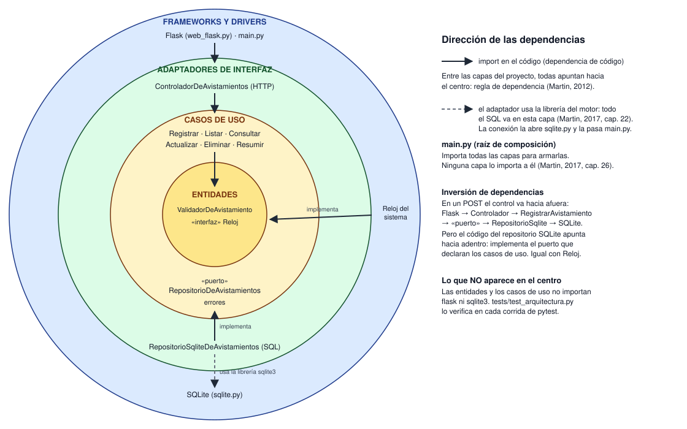

# Taller 5: Clean Architecture y arquitectura hexagonal

Sergio Valderrama · Ingeniería de Software 2 (ISW-2) · 11 de noviembre de 2026

**Repositorio:** https://github.com/SergioV645/API_Avistamientos (rama `main`)

**Arquitectura elegida:** Clean Architecture (Martin, 2012; Martin, 2017).

---

## Parte 1. Investigación

### 1. El problema de Cockburn, puertos, adaptadores y la simetría

**El problema.** Cockburn (2005) observa que en las aplicaciones de su época la lógica de negocio termina metida dentro del código de la interfaz de usuario. Eso trae tres consecuencias: no se puede probar esa lógica con pruebas automáticas, porque queda atada a detalles visuales que cambian todo el tiempo; es difícil pasar de un uso por personas a un uso por lotes (*batch*); y es difícil que otro programa maneje la aplicación. Describe además el mismo problema del otro lado: cuando la base de datos no está disponible o la están cambiando, el equipo se queda bloqueado (Cockburn, 2005). Su diagnóstico es que ambos problemas son uno solo: la lógica de negocio está enredada con la forma de hablar con lo que está afuera.

**Puerto.** Es un punto por donde la aplicación conversa con el exterior, definido por el *propósito* de esa conversación y no por la tecnología. En la práctica es una API: el conjunto de operaciones que la aplicación ofrece o necesita para un propósito (Cockburn, 2005). Toma la idea de los puertos de un computador, donde cualquier dispositivo que cumpla el protocolo se puede conectar.

**Adaptador.** Es el componente que traduce entre la API del puerto y una tecnología concreta. Para un mismo puerto puede haber varios adaptadores intercambiables: una interfaz gráfica, un arnés de pruebas automáticas, un programa por lotes o una interfaz HTTP del lado del usuario, y una base de datos SQL, un archivo plano o una base simulada en memoria del lado de los datos (Cockburn, 2005).

**La simetría.** Para Cockburn la división importante no es "arriba/abajo" ni "izquierda/derecha", como en los diagramas por capas, sino **adentro/afuera** (Cockburn, 2005). El usuario y la base de datos son, los dos, cosas que están afuera de la aplicación y que se conectan a ella por un puerto mediante un adaptador. Por eso los trata igual. La única diferencia que reconoce es quién inicia la conversación: los actores *primarios* (el usuario, una prueba) manejan la aplicación, y los *secundarios* (la base de datos) son manejados por ella; pero insiste en que esa distinción no cambia la arquitectura. La consecuencia práctica de la simetría es que se puede correr la aplicación completamente aislada: con un arnés de pruebas en el lado del usuario y una base simulada en el lado de los datos (Cockburn, 2005).

### 2. Los círculos de Martin y la regla de dependencia

Martin (2012) representa la arquitectura como círculos concéntricos, del más interno al más externo:

| Círculo | Qué va ahí | En mi API |
|---|---|---|
| **Entidades** | Las reglas de negocio más generales, las que menos cambian cuando cambia algo externo. | `ValidadorDeAvistamiento` (especie de 3 a 50 caracteres, fecha no posterior a hoy, lugar y observador no vacíos) y la abstracción `Reloj`. |
| **Casos de uso** | Las reglas propias de esta aplicación: cada cosa que el sistema hace, orquestando a las entidades. | `RegistrarAvistamiento`, `ListarAvistamientos`, `ConsultarAvistamiento`, `ActualizarAvistamiento`, `EliminarAvistamiento`, `ResumirPorEspecie`, y el puerto `RepositorioDeAvistamientos`. |
| **Adaptadores de interfaz** | Convierten los datos entre el formato cómodo para los casos de uso y el formato cómodo para algo externo (la web, la base de datos). Aquí van los controladores y todo el SQL. | `ControladorDeAvistamientos` (HTTP) y `RepositorioSqliteDeAvistamientos` (SQL). |
| **Frameworks y drivers** | Los detalles: el framework web, la base de datos, las herramientas. Casi solo código "pegamento". | Flask (`web_flask.py`), la conexión SQLite (`sqlite.py`), `RelojDelSistema` y `main.py`. |

(Martin, 2012; Martin, 2017, cap. 22)

Martin aclara que cuatro círculos es un esquema y que puede haber más, pero que la regla se aplica siempre (Martin, 2017, cap. 22).

**La regla de dependencia.** Las dependencias del código fuente solo pueden apuntar **hacia adentro**, hacia las políticas de más alto nivel (Martin, 2012). Lo que prohíbe es que algo de un círculo interno conozca algo de un círculo externo: no puede mencionar el nombre de ninguna función, clase o variable declarada afuera, ni usar formatos de datos definidos afuera, sobre todo los que genera un framework (Martin, 2017, cap. 22). Por ejemplo, un caso de uso no puede importar Flask ni recibir una fila de `sqlite3`.

### 3. Cómo guarda datos un caso de uso sin depender de la base de datos

**La contradicción.** El flujo de control va hacia afuera (el caso de uso tiene que llamar a algo que guarde en la base), pero la regla de dependencia exige que el código apunte hacia adentro.

**El mecanismo: inversión de dependencias.** Martin lo resuelve con el principio de inversión de dependencias (DIP): el círculo interno declara una **interfaz** con lo que necesita, y el círculo externo la **implementa** (Martin, 2012). Así, la dependencia del código va en sentido contrario al flujo de control justo en la frontera. En el artículo lo explica con el caso de uso que debe llamar al presentador a través de un "puerto de salida" (Martin, 2012), y en el libro lo aplica a la base de datos con los *gateways*: interfaces con un método por cada operación que los casos de uso necesitan, implementadas en la capa de la base de datos (Martin, 2017, cap. 23). Es el DIP de SOLID: los módulos de alto nivel no deben depender de módulos concretos, sino de abstracciones (Martin, 2017, cap. 11).

**Ejemplo en mi API.**

```python
# avistamientos/casos_de_uso/repositorio.py  (círculo de casos de uso)
class RepositorioDeAvistamientos(ABC):
    @abstractmethod
    def agregar(self, datos): ...

# avistamientos/casos_de_uso/avistamientos.py  (círculo de casos de uso)
class RegistrarAvistamiento:
    def __init__(self, repositorio, validador): ...
    def ejecutar(self, datos):
        ...
        return self.repositorio.agregar(datos)   # solo conoce la interfaz

# avistamientos/adaptadores/repositorio_sqlite.py  (círculo de adaptadores)
class RepositorioSqliteDeAvistamientos(RepositorioDeAvistamientos):
    def agregar(self, datos):
        self.con.execute("INSERT INTO avistamientos ...")   # aquí sí hay SQL

# avistamientos/main.py  (círculo externo): une las piezas
repositorio = RepositorioSqliteDeAvistamientos(abrir_conexion(ruta_db))
registrar = RegistrarAvistamiento(repositorio, validador)
```

En un `POST`, el control va de `RegistrarAvistamiento` hacia `RepositorioSqliteDeAvistamientos` (hacia afuera), pero el `import` va de `repositorio_sqlite.py` hacia `repositorio.py` (hacia adentro). `RegistrarAvistamiento` nunca nombra a SQLite. Quien decide qué implementación se usa es `main.py`, el componente que Martin describe como el más "sucio" y el único que conoce todo (Martin, 2017, cap. 26). Lo mismo hice con la fecha de hoy: la entidad depende de la interfaz `Reloj` y `RelojDelSistema` la implementa afuera.

### 4. Hexagonal, cebolla y Clean Architecture

**Lo que tienen en común.** Las tres ponen la lógica de negocio en el centro y empujan la infraestructura (interfaz de usuario, base de datos, frameworks) al borde, como algo reemplazable (Cockburn, 2005; Palermo, 2008; Martin, 2012). Las tres logran esa separación definiendo interfaces en el centro e implementándolas afuera, de modo que el núcleo no dependa de la infraestructura: Palermo lo dice explícitamente al ubicar en el núcleo solo la *interfaz* del repositorio y su implementación en el borde (Palermo, 2008), y Martin lo convierte en la regla de dependencia (Martin, 2012). Y las tres buscan lo mismo: poder probar la lógica sin la base de datos ni la interfaz. Martin dice que estas arquitecturas comparten el objetivo de separar responsabilidades y que, aunque varían en detalles, son muy parecidas (Martin, 2017, cap. 22). Palermo, por su parte, reconoce que parte de la misma premisa que la hexagonal de Cockburn (Palermo, 2008).

**Lo que cambia.**

| | Hexagonal (Cockburn, 2005) | Cebolla (Palermo, 2008) | Clean (Martin, 2012) |
|---|---|---|---|
| Vocabulario | Puertos, adaptadores, actores primarios y secundarios | Modelo de dominio, capas alrededor del núcleo, infraestructura | Entidades, casos de uso, adaptadores de interfaz, frameworks y drivers |
| Capas | Dos regiones: adentro y afuera. No ordena el interior | Varias capas concéntricas; el número varía. El modelo de dominio va en el centro | Cuatro círculos como esquema; pueden ser más |
| Énfasis | La simetría usuario/base de datos y poder correr la aplicación aislada con distintos adaptadores | El acoplamiento: "todo acoplamiento va hacia el centro" y la base de datos *no* es el centro | Una sola regla general (la de dependencia) y qué datos pueden cruzar las fronteras (estructuras simples, no entidades ni filas) |
| Interior | No dice cómo organizarlo | El modelo de dominio en el centro y, a su alrededor, capas con más comportamiento; las interfaces de repositorio en la primera capa | Separa reglas de la empresa (entidades) de reglas de la aplicación (casos de uso) |

En resumen: cambia sobre todo el vocabulario y el detalle con que se organiza el interior. Cockburn define solo la frontera adentro/afuera; Palermo agrega capas dentro del núcleo; Martin unifica las propuestas anteriores en un solo diagrama y le pone nombre a la regla que todas siguen (Martin, 2017, cap. 22).

### 5. ¿Se justifica Clean Architecture en una API tan pequeña?

**Mi posición: aplicada completa, no se justifica para una API de este tamaño en un proyecto real; sí se justifica su núcleo mínimo.** La mantengo completa en este repositorio porque es un ejercicio del curso y la API crece taller a taller.

**Costo concreto.** El código pasó de **3 archivos y unas 190 líneas** (`app.py`, `db.py`, `validador.py`) a **17 archivos y unas 340 líneas** (sin contar líneas vacías ni comentarios). Un `POST` ahora atraviesa cinco módulos (Flask → controlador → caso de uso → validador → repositorio) en vez de una función. Hay interfaces con una sola implementación (`RepositorioDeAvistamientos` solo tiene la de SQLite) y una clase solo para transportar la respuesta (`RespuestaHttp`). Para alguien nuevo, entender dónde está cada cosa toma más tiempo. Palermo (2008) advierte que su arquitectura está pensada para aplicaciones de negocio complejas y de larga vida, no para sitios pequeños.

**Beneficio concreto.** Ahora los casos de uso se prueban sin SQLite ni Flask: `tests/test_casos_de_uso.py` usa un repositorio *fake* en memoria, que es exactamente el adaptador simulado del que habla Cockburn (2005). Antes no se podía, porque la lógica estaba dentro de las rutas de Flask y llamaba directo a SQLite. Además, cambiar SQLite por PostgreSQL solo tocaría `repositorio_sqlite.py` y `sqlite.py`, y cambiar Flask por otro framework solo tocaría `web_flask.py`, porque ninguna capa interna los nombra (Martin, 2012). Y la regla de dependencia quedó verificada automáticamente por `tests/test_arquitectura.py`.

**Por qué el núcleo mínimo.** La mayor parte del beneficio viene de dos separaciones baratas: sacar la regla de negocio a una entidad (ya lo había hecho en el taller de pruebas) y poner la base de datos detrás de una interfaz de repositorio. Eso da pruebas sin infraestructura y una base reemplazable. Las capas extra (controlador independiente de Flask, `RespuestaHttp`, un caso de uso por operación) aportan poco mientras la API tenga seis operaciones casi sin reglas. Si la API creciera, con autenticación, más entidades o otro canal además de HTTP, ese costo empezaría a pagarse.

---

## Parte 2. Aplicación

### Repositorio y rama

- Repositorio: https://github.com/SergioV645/API_Avistamientos
- Rama: `main`
- Commits del refactor, en orden (cada uno deja las pruebas en verde y la API respondiendo igual):

| # | Commit | Qué hizo |
|---|---|---|
| 1 | Add .gitignore and remove `__pycache__` from the repository | Limpieza previa: se habían subido archivos compilados. |
| 2 | Move the business rule to the entities layer | `validador.py` → `avistamientos/entidades/`; nace la interfaz `Reloj`; `RelojDelSistema` sale al círculo externo. |
| 3 | Define the `RepositorioDeAvistamientos` port and its SQLite adapter | Interfaz en casos de uso, SQL en adaptadores. Se elimina `db.py`; `app.py` deja de importar `sqlite3`. |
| 4 | Extract the use cases (interactors) | Las rutas ya no validan ni guardan: llaman a un caso de uso. |
| 5 | Separate HTTP controller, Flask and the composition root | Controlador sin Flask, Flask como pegamento, `main.py` arma todo. |
| 6 | Add use case tests with a fake repository and a dependency rule test | 13 pruebas nuevas. Las 42 anteriores no cambian. |
| 7 | Add Taller 5 document, dependency diagram and update README | Este documento. |

### Estructura de carpetas

```
API_Avistamientos/
├── app.py                         Punto de entrada: `python app.py`
├── avistamientos/
│   ├── entidades/                 ① Entidades
│   │   ├── reloj.py                  «interfaz» Reloj
│   │   └── validador.py              ValidadorDeAvistamiento (regla de negocio)
│   ├── casos_de_uso/              ② Casos de uso
│   │   ├── avistamientos.py          Registrar, Listar, Consultar, Actualizar, Eliminar, ResumirPorEspecie
│   │   ├── repositorio.py            «puerto» RepositorioDeAvistamientos
│   │   └── errores.py                DatosInvalidos, AvistamientoNoEncontrado, AvistamientoRepetido
│   ├── adaptadores/               ③ Adaptadores de interfaz
│   │   ├── controlador_http.py       ControladorDeAvistamientos + RespuestaHttp (sin Flask)
│   │   └── repositorio_sqlite.py     RepositorioSqliteDeAvistamientos (todo el SQL)
│   ├── frameworks_y_drivers/      ④ Frameworks y drivers
│   │   ├── web_flask.py              Rutas de Flask (pegamento)
│   │   ├── sqlite.py                 Abre la conexión SQLite
│   │   └── reloj_del_sistema.py      RelojDelSistema (implementa Reloj)
│   └── main.py                    Raíz de composición: une todas las capas
├── tests/
│   ├── test_validador.py          Unitarias de la entidad (taller de pruebas)
│   ├── test_api.py                Integración por HTTP (taller de pruebas)
│   ├── test_casos_de_uso.py       Unitarias de los casos de uso con fake (nuevo)
│   ├── test_arquitectura.py       Verifica la regla de dependencia (nuevo)
│   ├── dobles.py                  RelojFijo (stub) y RepositorioEnMemoria (fake)
│   └── conftest.py
└── docs/
    ├── taller5-clean-architecture.md   Este documento
    ├── diagrama-dependencias.svg
    ├── evidencia/                     Salidas de pruebas, cobertura y API, antes y después
    └── justificacion-pruebas.md        Taller de pruebas
```

### Diagrama de dependencias



Cada flecha sólida es un `import` y todas apuntan hacia el centro. Los dos puntos donde el control va hacia afuera (guardar en la base y preguntar la fecha de hoy) se resolvieron con inversión de dependencias: el repositorio SQLite y el reloj del sistema *implementan* interfaces declaradas adentro.

La flecha punteada es la única que sale hacia un detalle: el adaptador usa la librería `sqlite3`. Es intencional, porque Martin ubica todo el SQL en la capa de adaptadores (Martin, 2017, cap. 22). Ningún código de los dos círculos internos importa `sqlite3` ni `flask`, y `tests/test_arquitectura.py` lo comprueba en cada corrida.

### Decisiones para ser consistente con Clean Architecture (y no mezclar)

- **Nombres de Martin, no de Cockburn ni de Palermo:** las carpetas se llaman como sus círculos (entidades, casos de uso, adaptadores, frameworks y drivers). Uso la palabra "puerto" solo donde Martin también la usa: para la interfaz que el caso de uso declara para salir de su círculo (en el artículo, *output port*).
- **Los datos que cruzan las fronteras son estructuras simples** (diccionarios), nunca filas de `sqlite3` ni objetos de Flask (Martin, 2017, cap. 22). Por eso el repositorio convierte cada fila con `dict(fila)` antes de devolverla.
- **Simplificación consciente:** no implementé un presentador con su puerto de salida por cada caso de uso. Los casos de uso devuelven un diccionario o lanzan un error, y el controlador lo convierte en la respuesta HTTP. Martin acepta que los datos crucen la frontera como argumentos o valores de retorno simples (Martin, 2017, cap. 22), y en esta API el JSON de salida es igual a los datos, así que un presentador no tendría nada que formatear.

---

## Evidencia: antes y después

La salida completa está en `docs/evidencia/antes_pruebas.txt` y `docs/evidencia/despues_pruebas.txt`.

### Pruebas y cobertura **antes** del refactor (commit `46e500b`)

```
$ python -m pytest --cov --cov-report=term-missing
collected 42 items
tests/test_api.py ..................                                     [ 42%]
tests/test_validador.py ........................                         [100%]

Name           Stmts   Miss Branch BrPart  Cover   Missing
----------------------------------------------------------
app.py            68      3     12      1    95%   79, 83, 89
db.py             31      0      0      0   100%
validador.py      43      0     14      0   100%
----------------------------------------------------------
TOTAL            142      3     26      1    98%
42 passed
```

### Pruebas y cobertura **después** del refactor

```
$ python -m pytest --cov --cov-report=term-missing
collected 55 items
tests/test_api.py ..................                                     [ 32%]
tests/test_arquitectura.py ......                                        [ 43%]
tests/test_casos_de_uso.py .......                                       [ 56%]
tests/test_validador.py ........................                         [100%]

Name                                                      Stmts   Miss Branch BrPart  Cover   Missing
-----------------------------------------------------------------------------------------------------
app.py                                                        4      1      2      1    67%   8
avistamientos/adaptadores/controlador_http.py                51      0      0      0   100%
avistamientos/adaptadores/repositorio_sqlite.py              39      0      0      0   100%
avistamientos/casos_de_uso/avistamientos.py                  49      0     10      0   100%
avistamientos/casos_de_uso/errores.py                         8      0      0      0   100%
avistamientos/casos_de_uso/repositorio.py                    14      0      0      0   100%
avistamientos/entidades/reloj.py                              4      0      0      0   100%
avistamientos/entidades/validador.py                         41      0     14      0   100%
avistamientos/frameworks_y_drivers/reloj_del_sistema.py       5      0      0      0   100%
avistamientos/frameworks_y_drivers/sqlite.py                  5      0      0      0   100%
avistamientos/frameworks_y_drivers/web_flask.py              34      2      2      0    94%   43, 47
avistamientos/main.py                                        12      0      0      0   100%
-----------------------------------------------------------------------------------------------------
TOTAL                                                       266      3     28      1    99%
55 passed
```

(Se omiten los `__init__.py`, que no tienen código y salen al 100 %.)

**Lectura.**

- **Las 42 pruebas originales siguen pasando sin cambios en su lógica.** El único cambio en ellas es una línea: el `import` de `tests/test_validador.py`, porque el validador cambió de carpeta (`git diff 46e500b HEAD -- tests/test_api.py tests/test_validador.py tests/conftest.py` muestra solo esa línea). `test_api.py` y `conftest.py` siguen usando `from app import crear_app` exactamente igual.
- **Corriendo solo esas 42 pruebas sobre el código nuevo**, la cobertura también es del 99 %: el refactor no dejó código sin probar.
- **Las 3 líneas sin cubrir son las mismas de antes**, solo que cambiaron de archivo: los manejadores de error 404 y 405 de Flask (antes `app.py` 79 y 83, ahora `web_flask.py` 43 y 47) y el arranque del servidor (antes `app.py` 89, ahora `app.py` 8). En el taller de pruebas ya había justificado por qué no vale la pena probarlas.
- Hay unos avisos `ResourceWarning: unclosed database` que ya aparecían antes del refactor: las pruebas crean una base en memoria por prueba y no la cierran. No afectan los resultados.

### La API responde igual

Levanté la API real (`python app.py`) con una base vacía, antes y después del refactor, e hice la misma secuencia de 17 peticiones con `curl` (script `docs/evidencia/muestra_api.sh`). Las dos salidas, guardadas en `docs/evidencia/antes_api.txt` y `docs/evidencia/despues_api.txt`, son **idénticas byte a byte** (`diff` no muestra diferencias). Aquí van en formato compacto:

```
POST /avistamientos -> {"id": 1, "especie": "Colibrí", "lugar": "Bogotá", "fecha": "2026-10-01", "observador": "Sergio"} [201]
POST /avistamientos -> {"id": 2, "especie": "Tucán", "lugar": "Minca", "fecha": "2026-09-20", "observador": "Laura"} [201]
POST (repetido) /avistamientos -> {"error": "Ya existe un avistamiento con la misma especie, lugar, fecha y observador"} [409]
POST (inválido) /avistamientos -> {"error": "Datos inválidos", "detalles": [{"campo": "especie", "mensaje": "debe tener entre 3 y 50 caracteres (tiene 2)"}, {"campo": "fecha", "mensaje": "no puede ser posterior a hoy"}, {"campo": "lugar", "mensaje": "no puede estar vacío"}]} [400]
POST (JSON malo) /avistamientos -> {"error": "Datos inválidos", "detalles": [{"campo": "cuerpo", "mensaje": "El cuerpo debe ser un objeto JSON"}]} [400]
GET /avistamientos -> [{"id": 1, "especie": "Colibrí", ...}, {"id": 2, "especie": "Tucán", ...}] [200]
GET /avistamientos/1 -> {"id": 1, "especie": "Colibrí", "lugar": "Bogotá", "fecha": "2026-10-01", "observador": "Sergio"} [200]
GET /avistamientos/99 -> {"error": "Avistamiento no encontrado"} [404]
PUT /avistamientos/1 -> {"id": 1, "especie": "Barranquero", "lugar": "Parque Arví", "fecha": "2026-09-28", "observador": "Sergio"} [200]
PUT (inválido) /avistamientos/1 -> {"error": "Datos inválidos", "detalles": [{"campo": "fecha", "mensaje": "debe tener el formato AAAA-MM-DD"}]} [400]
PUT (repetido) /avistamientos/2 -> {"error": "Ya existe un avistamiento con la misma especie, lugar, fecha y observador"} [409]
PUT /avistamientos/99 -> {"error": "Avistamiento no encontrado"} [404]
GET /avistamientos/resumen -> {"total": 2, "porEspecie": [{"especie": "Barranquero", "cantidad": 1}, {"especie": "Tucán", "cantidad": 1}]} [200]
DELETE /avistamientos/2 -> [204]
DELETE /avistamientos/2 -> {"error": "Avistamiento no encontrado"} [404]
PATCH (no existe) /avistamientos/1 -> {"error": "Método no permitido"} [405]
GET /no-existe -> {"error": "Ruta no encontrada"} [404]
```

---

## Lo más difícil de separar

**El error 409 de los avistamientos repetidos.** Era lo que más mezclaba capas. La regla "no puede haber dos avistamientos iguales" no la aplicaba el código sino la base de datos, con un índice `UNIQUE ... COLLATE NOCASE`, y el controlador la detectaba atrapando `sqlite3.IntegrityError`. Es decir, el controlador importaba `sqlite3`: la capa web conocía un detalle de la base de datos, justo lo que prohíbe la regla de dependencia (Martin, 2012).

Tenía dos opciones:

1. **Mover la regla a un caso de uso**: antes de guardar, buscar si ya existe uno igual. El problema es que entre la búsqueda y el `INSERT` otra petición podría guardar el mismo avistamiento, y además tendría que reproducir en Python la comparación sin mayúsculas que hace SQLite. Cambiaría el comportamiento de la API.
2. **Dejar la regla en el índice, pero traducir el error dentro del adaptador**: el repositorio SQLite atrapa `sqlite3.IntegrityError` y lanza `AvistamientoRepetido`, un error declarado en la capa de casos de uso.

Elegí la segunda, porque la API debía responder igual. Así ningún círculo interno conoce `sqlite3` (el controlador recibe `AvistamientoRepetido` y lo convierte en 409) y el contrato quedó escrito en la interfaz del puerto: `agregar` y `actualizar` lanzan `AvistamientoRepetido`. El costo es que una regla de negocio sigue viviendo en un detalle (la base de datos). Por eso el repositorio *fake* de las pruebas tiene que imitar ese comportamiento, y si algún día cambio de base de datos tendré que acordarme de crear la misma restricción.

**Otros dos puntos que costaron:**

- **Que la API respondiera idéntico.** El orden de las validaciones importa: en un `PUT` con un id que no existe *y* datos inválidos, la API respondía 404, no 400. Al mover la lógica al caso de uso `ActualizarAvistamiento` tuve que conservar ese orden (primero buscar, después validar), y lo dejé fijado con una prueba (`test_actualizar_un_id_inexistente_da_no_encontrado_antes_de_validar`). También la configuración del JSON (tildes sin escapar y el `id` primero) tuvo que quedarse en la capa de Flask, que es la que serializa.
- **El reloj.** La regla "la fecha no puede ser posterior a hoy" vive en la entidad, pero saber qué día es hoy es un detalle del sistema operativo. La resolví igual que el repositorio: la interfaz `Reloj` está en la capa de entidades y `RelojDelSistema` la implementa afuera. Así el stub `RelojFijo` del taller de pruebas siguió funcionando sin cambios.

---

## Referencias

- Cockburn, A. (2005). *Hexagonal architecture*. https://alistair.cockburn.us/hexagonal-architecture/ (secciones *Intent*, *Motivation* y *Nature of the solution*).
- Martin, R. C. (2012, 13 de agosto). *The Clean Architecture*. The Clean Code Blog. https://blog.cleancoder.com/uncle-bob/2012/08/13/the-clean-architecture.html
- Martin, R. C. (2017). *Clean Architecture: A Craftsman's Guide to Software Structure and Design*. Prentice Hall. Capítulos 11 (*DIP: The Dependency Inversion Principle*), 22 (*The Clean Architecture*), 23 (*Presenters and Humble Objects*) y 26 (*The Main Component*).
- Palermo, J. (2008). *The Onion Architecture: part 1*. https://jeffreypalermo.com/2008/07/the-onion-architecture-part-1/
